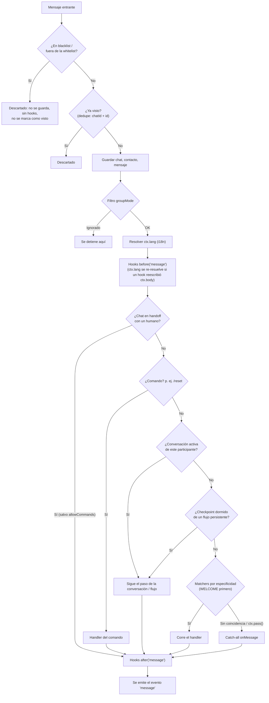

# Conceptos básicos

Un bot es un `Bot` más un **provider** (el transporte), y las piezas que
registras en él: handlers, flujos, hooks y plugins. Esta página muestra cada
pieza, el objeto `ctx` que recibe todo handler y el orden en que un mensaje
entrante pasa por ellas.

## Las piezas

### Bot y provider

```ts
import { Bot } from '@botmesh/core'
import { BaileysProvider } from '@botmesh/baileys'

const bot = new Bot({ provider: new BaileysProvider({ session: 'mi-bot' }) })
// registra aquí handlers, flujos, hooks y plugins, y después:
await bot.start()
```

El `Bot` (de `@botmesh/core`) es el motor agnóstico de transporte: ejecuta el
dispatcher, los hooks, los flujos, las conversaciones y el scheduler. El
**provider** es el transporte: `@botmesh/baileys` (WhatsApp Web),
`@botmesh/meta` (WhatsApp Cloud API), `@botmesh/telegram` y los
[demás canales](./canales) entregan al bot los mismos eventos normalizados, así
que el código que registras funciona en cualquiera de ellos. Todas las opciones
de `new Bot()` están en la [referencia de configuración](./configuracion).

### `when`: respuestas simples

```ts
bot.when('hola', async (ctx) => {
  await ctx.reply('👋 ¡Hola!')
})
```

Cuando un mensaje coincide con el trigger, se ejecuta el handler. Un texto
simple compara por **igualdad normalizada**: se ignoran mayúsculas, tildes y
espacios de más, así que `'hola'` coincide con "Hola" y "  hóla ", pero no con
"/hola" ni con "hola amigo". Los triggers admiten otras formas:

| Trigger | Coincide con |
| --- | --- |
| `'hola'` | el texto, normalizado |
| `['chao', 'adiós']` | cualquiera de ellos |
| `/\d{4,}/` | una expresión regular |
| `{ pattern: 'factura', match: 'contains', scope: 'dm' }` | `match`: `'equals'` (por defecto), `'contains'`, `'startsWith'` o `'endsWith'`; `scope`: `'dm'`, `'group'` o `'all'` |
| `(m) => m.body.length > 200` | un predicado síncrono sobre `{ body, isGroup }` |
| `IMAGE`, `LOCATION`, `WELCOME`, `CALL`… | tipos de mensaje y eventos especiales, ver [Triggers especiales](./triggers) |

`bot.command('ayuda', handler)` registra un comando `/ayuda` (el prefijo es
`commandPrefix`), y `bot.onMessage(handler)` es el catch-all para lo que nada
más manejó.

### `flow` y `conversation`: conversaciones de varios pasos

```ts
import { flow } from '@botmesh/core'

const registro = flow('registro')
  .ask('¿Tu nombre?', 'name')
  .say((_ctx, c) => `Hola ${c.state.name}`)

bot.use(registro)
```

Un **flujo** es la descripción encadenable de una conversación: el bot
pregunta, el usuario responde, `c.state` guarda la respuesta y el flujo sigue,
con validación, reintentos, menús y timeouts. Compila al mismo runtime que
`bot.conversation(nombre, async (c, ctx) => { ... })`, que escribes a mano
cuando necesitas bucles o lógica arbitraria. Ver
[Flujos conversacionales](./flujos).

### Hooks: middleware

```ts
bot.before('message', async (ctx, next) => {
  bot.logger.debug({ type: ctx.type }, 'mensaje entrante')
  await next()                      // sin next() el mensaje se detiene aquí
})

bot.onError('message', async (ctx, error) => {
  await ctx?.reply('😅 Algo salió mal, inténtalo de nuevo.')
})
```

Los hooks `before` corren antes del enrutado y pueden detener o reescribir un
mensaje; los `after` corren cuando ya se manejó; los `onError` cuando un
handler lanza un error. Los hooks de `'send'` ven cada mensaje saliente. Ver
[Hooks](./hooks).

### Plugins: funciones empaquetadas

```ts
import { slashCommandsPlugin } from '@botmesh/core'

const unplug = bot.plug(slashCommandsPlugin, { greeting: '¡Hola! Envía /help.' })
```

Un plugin agrupa handlers, hooks y herramientas. `bot.plug()` devuelve una
función `unplug()` que deshace lo que registró el plugin. Un `name` de plugin
se puede enchufar una vez por bot, salvo que su spec ponga `multiple: true`.
Ver [Plugins](./plugins).

## El objeto `ctx`

Todo handler recibe un `MessageContext`. Lo que te **dice**:

| Campo | Qué contiene |
| --- | --- |
| `ctx.body` | El texto, o el caption de un mensaje con media (`''` si no hay). |
| `ctx.type` | `'text'`, `'image'`, `'video'`, `'audio'`, `'voice'`, `'document'`, `'sticker'`, `'location'`, `'contact'`, `'poll'`, `'buttons'`, `'call'`… |
| `ctx.from` | El id del chat: adonde van las respuestas. |
| `ctx.sender` | Quién lo envió: igual a `from` en un privado, el participante en un grupo. |
| `ctx.senderInfo` | `{ id, displayName?, language?, … }` tal como lo reporta el provider. |
| `ctx.isGroup`, `ctx.isPrivate` | Tipo de chat. |
| `ctx.timestamp` | Cuándo se envió, en milisegundos epoch en todos los canales. |
| `ctx.ref` | `{ id, chatId }` de este mensaje, para citarlo, reaccionar, editarlo o borrarlo. |
| `ctx.quoted`, `ctx.mentions` | El mensaje al que responde y los usuarios que menciona. |
| `ctx.media`, `ctx.sharedLocation` | Metadatos de la media (descárgala con `loadMediaOf(ctx)`) y una ubicación recibida. |
| `ctx.interaction` | Un toque en un botón o lista: `{ id, data }`. |
| `ctx.lang`, `ctx.user`, `ctx.tools` | El idioma resuelto, los [datos persistentes](./datos-usuario) del usuario y las [herramientas inyectadas](./di). |

Lo que **hace**:

| Método | Qué hace |
| --- | --- |
| `ctx.reply(texto)` | Envía texto al chat. |
| `ctx.photo()`, `ctx.video()`, `ctx.audio()`, `ctx.voice()`, `ctx.file()`, `ctx.sticker()` | Envía media. |
| `ctx.location()`, `ctx.contact()`, `ctx.poll()`, `ctx.buttons()` | Envía una ubicación, un contacto, una encuesta o botones. |
| `ctx.quote(texto)`, `ctx.react(emoji)`, `ctx.edit(…)`, `ctx.delete()` | Responde citando el mensaje, reacciona, edita o borra un mensaje. |
| `ctx.stream(fuente)` | Envía texto a medida que se genera. Ver [Streaming](./streaming). |
| `ctx.typing()`, `ctx.recording()`, `ctx.markRead()` | Señales de presencia (sin garantía). |
| `ctx.supports(función)` | Si el canal puede hacer algo, antes de intentarlo. |
| `ctx.t(clave, params)`, `ctx.setLang(código)` | Traduce y cambia el idioma del usuario. Ver [i18n](./i18n). |
| `ctx.handoff()` | Pasa el chat a un humano. Ver [Handoff](./handoff). |
| `ctx.pass()`, `ctx.abort()` | Deja que el siguiente handler tome el mensaje; lo detiene (en hooks `before`). |

Todos los helpers de envío están en [Mensajes y media](./mensajes).

## Ids de chat y remitente

`ctx.from` (chat) y `ctx.sender` (usuario) son **strings opacos** que elige el
provider; el core nunca los interpreta. Guárdalos y compáralos tal como
llegan. En WhatsApp (Baileys) son JIDs:

| Tipo | Formato | Ejemplo |
| --- | --- | --- |
| Usuario | `numero@s.whatsapp.net` | `573001234567@s.whatsapp.net` |
| Grupo | `id@g.us` | `120363xxx@g.us` |
| Canal | `id@newsletter` | `120363xxx@newsletter` |

Telegram usa ids numéricos, la Cloud API números de teléfono, etc. El provider
también resuelve los alias: la misma persona llega siempre con el mismo
`ctx.sender`, aunque WhatsApp alterne entre su número y un LID.

## El pipeline de entrada

Todo mensaje entrante pasa por los mismos pasos, en este orden. Los cuatro
primeros corren en cuanto el provider emite el evento; el resto corre en una
**cola FIFO por chat**, así que dos mensajes del mismo chat nunca se procesan a
la vez. El primer handler que **consume** el mensaje detiene el enrutado:



1. **Blacklist / whitelist**: un remitente o chat bloqueado se descarta en
   silencio. No se guarda, no corre ningún hook, no se emite `'message'` y
   **no se marca como visto**, así que una reentrega tras desbloquearlo se
   procesa. Ver [Handoff y listas de acceso](./handoff#blacklist-y-whitelist).
2. **Dedupe de entrada**: un mensaje reenviado (mismo `chatId` + id, por un
   reintento de webhook o una reconexión) se descarta. Ver
   [Dedupe de entrada](#dedupe-de-entrada). Con el
   [procesamiento durable](./durabilidad) activo, el evento se escribe después
   en el journal de entrada, así que tras una caída se reproduce desde el paso 1.
3. **Persistencia**: el chat, el contacto y el mensaje se guardan en el store.
4. **Filtro `groupMode`**: un mensaje de grupo que el bot debe ignorar se
   detiene aquí (se guarda igual).
5. **Idioma y después hooks `before('message')`**: con [i18n](./i18n) activo,
   primero se resuelve `ctx.lang`, así que hooks y handlers ya lo ven. Luego
   corren los hooks, que pueden hacer `abort()` del mensaje. Si un hook
   reescribió `ctx.body` (la transcripción de `@botmesh/voice`, por ejemplo) y
   el idioma salió de `detect` o del valor por defecto, se resuelve otra vez
   sobre el texto nuevo.
6. **Puerta de handoff**: mientras un chat está
   [en manos de un humano](./handoff), se saltan los pasos 7–11 (salvo
   `handoff.allowCommands`). El mensaje se guarda igual, los hooks corren y
   `'message'` se emite.
7. **Comandos** (`/reset`, `/help`…): siempre ganan, incluso a una
   conversación activa. Por eso `/reset` sirve para salir de un flujo atascado.
8. **Conversación activa**: si este participante está en un flujo o en una
   `bot.conversation` esperando respuesta, el mensaje va ahí.
9. **Reanudación dormida**: un flujo `.persistent()` con checkpoint en el
   store (por ejemplo antes de un reinicio) se reanuda en el paso guardado.
10. **Matchers** registrados con `bot.when()` y `bot.onType()`, por
    especificidad: [`WELCOME`](./triggers#welcome) (solo el primer contacto),
    luego texto exacto, `startsWith`, `endsWith`, regex, `contains`,
    predicados, tipo único (`IMAGE`) y triggers multi-tipo (`MEDIA`). A igual
    especificidad gana el registrado primero. Ver
    [Precedencia](./triggers#precedencia).
11. **`bot.onMessage()`**: el catch-all (`aiPlugin` es uno). Corre **solo** si
    nada de lo anterior consumió el mensaje.
12. **Final**: hooks `after('message')` y después el evento `'message'` (aquí
    se rearman los timers de `bot.onIdle`).

Si un handler lanza un error, corren los hooks `onError('message')` y el error
se emite en `bot.on('error', ({ error, ctx }) => ...)`, haya o no un hook de
error.

### Los handlers consumen por defecto

En cuanto corre un handler, el enrutado se detiene ahí. Llama a `ctx.pass()`
para entregar el mensaje al siguiente handler que coincida:

```ts
bot.when(/.+/, async (ctx) => {
  if (ctx.type === 'image') { ctx.pass(); return } // que lo tome el handler de imágenes
  await ctx.reply('texto recibido')
})

bot.onType('image', async (ctx) => {
  await ctx.reply('imagen recibida')
})
```

### El evento `'message'` vs `onMessage()`

- `bot.on('message', ctx => ...)` se dispara con **cada** mensaje que el
  dispatcher terminó, incluidos los que consumió un comando, una conversación
  o un `when`. Úsalo para logs e integraciones de bandeja de entrada.
- `bot.onMessage(ctx => ...)` es el handler **catch-all**: solo corre cuando
  nada más consumió el mensaje.

### Llamadas, `bot.trigger()` y réplicas

- Las **llamadas** siguen un camino más corto: las listas de acceso y la
  puerta de handoff van **primero** y bloquean la llamada por completo (sin
  hooks `'call'`, evento ni trigger `CALL`; cuenta en `metrics().dropped`). Una
  llamada admitida corre los hooks `before`/`after('call')` y el evento
  `'call'`, y después solo los [triggers `CALL`](./triggers#call): sin hooks de
  mensaje, comandos ni evento `'message'`.
- **`bot.trigger(nombre, { chatId })`** inicia un flujo sin mensaje entrante
  (ver [Iniciar un flujo desde código](./mensajes#iniciar-un-flujo-desde-codigo)).
  Comprueba las listas de acceso, espera el turno FIFO del chat, comprueba la
  puerta de handoff, resuelve el idioma e inicia la conversación. Sin dedupe,
  persistencia, hooks de mensaje, matchers ni evento `'message'`.
- **Con [`coordination`](./replicas)** (varias réplicas) hay un paso más entre
  el 4 y el 5: el mensaje espera el **turno** de su chat, así que el FIFO por
  chat se mantiene entre réplicas. Un mensaje que no consigue su turno se
  descarta y se reporta en `'error'` (su id de dedupe se libera, así que una
  reentrega se procesa).

## Las conversaciones de grupo son por participante

En un grupo, dos participantes que hablan con el bot tienen **conversaciones
independientes** por defecto: uno puede estar a mitad de un registro mientras
el otro pide el menú. Usa `conversationScope: 'chat'` para tener una sola
conversación compartida por grupo:

```ts
const bot = new Bot({ provider, conversationScope: 'chat' })
```

El handoff, `groupMode` y el evento `'message'` siguen siendo por chat en
ambos casos.

## Dedupe de entrada

Los transportes por webhook (Cloud API, Messenger, Instagram, webhook de
Telegram) reintentan una entrega cuando no reciben un 2xx a tiempo, y Baileys
puede reenviar mensajes recientes tras reconectar. Sin protección, el mismo
mensaje arrancaría un flujo dos veces, o se tomaría como respuesta a la
*siguiente* pregunta. El bot descarta las reentregas antes de que las vea
ningún handler. Está **activado por defecto**:

```ts
new Bot({ provider })                                     // por defecto: { size: 1000 }, sin TTL
new Bot({ provider, dedupe: { size: 5000, ttl: '1h' } })  // ajustarlo
new Bot({ provider, dedupe: false })                      // desactivarlo
```

- Un mensaje se identifica por `chatId` + `ref.id` (algunos transportes solo
  garantizan ids únicos por chat). Un toque en un botón o lista se identifica
  por su `interactionId`, así que dos toques en el mismo menú son dos eventos.
- **Ediciones**: el mismo id con un cuerpo **distinto** (una edición de
  Telegram) se procesa; un reintento idéntico se descarta. Solo se guarda un
  hash del cuerpo.
- Los eventos con id vacío nunca se deduplican.
- Un mensaje bloqueado nunca se registra, así que el mismo id reenviado tras
  desbloquear se procesa.
- Si la persistencia falla antes de los handlers (store caído), o el mensaje
  sigue en cola cuando corre `bot.stop()`, la clave se libera para que una
  reentrega se procese.
- `size` limita un LRU; `ttl` (una [duración](./configuracion#duraciones))
  cuenta desde la primera aceptación.
- **Límite:** vive en la memoria del proceso, así que no deduplica entre
  réplicas ni tras un reinicio. Eso lo cubre el
  [procesamiento durable](./durabilidad).

Los providers deben dar a cada evento entrante un id que nombre exactamente un
evento, no cambie cuando se reenvía y sea `''` cuando el transporte no pueda
garantizarlo (el **contrato de ids de entrada** de `IProvider`).

## Filtro de ecos

Todo provider marca los mensajes del propio bot con `fromMe`, y el core los
descarta primero. Algunos transportes solo conocen su propio id tras un
handshake, y un buzón o gateway puede devolver un mensaje que el bot acaba de
enviar sin esa marca. `echoFilter` añade una segunda protección: el bot
recuerda las refs de sus envíos correctos y descarta un mensaje entrante que
traiga una de ellas, antes de las listas de acceso, el dedupe y el journal.

```ts
new Bot({ provider, echoFilter: true })                       // 1000 refs, sin TTL
new Bot({ provider, echoFilter: { size: 5000, ttl: '10m' } }) // ajustarlo
```

Está desactivado por defecto. Los descartes cuentan en
`metrics().dropped.echo` (Prometheus: `botmesh_dropped_total{reason="echo"}`).
La memoria es por proceso, y cada ref recordada se consume con el primer eco
que coincide.

## Entradas del paquete

| Importa desde | Para |
| --- | --- |
| `@botmesh/core` | Aplicaciones: el `Bot`, el DSL de flujos, los tipos de mensaje, las opciones y los errores que puedes capturar. |
| `@botmesh/core/testing` | Tests: `createTestBot`, `MockProvider`, el kit de caos, transcripciones doradas, simulación de caídas y `MemoryCoordinator`. Ver [Testing](./testing). |
| `@botmesh/core/testing/vitest` | Matchers de Vitest (`toHaveReplied`…). |
| `@botmesh/core/spi` | Autores de stores, backends de durabilidad, stores de tareas, coordinadores, integraciones de trazas y transportes: `KvDurability`, `MemoryKv`, `MemoryScheduleStore`, `messageKey`, `toInboundLocation`, los tipos de registro… Cubierto por semver. |
| `@botmesh/core/dev` | El [simulador en la terminal](./simulador) `botmesh dev`. |
| `@botmesh/core/internal` | Clases del motor (`Dispatcher`, `ConversationRuntime`, `HookSystem`…). Sin garantía semver: no lo uses desde una aplicación. |

## Siguientes pasos

- [Referencia de configuración](./configuracion): todas las opciones de `new Bot()`, eventos, logs y errores
- [Mensajes y media](./mensajes): todos los tipos de respuesta
- [Flujos conversacionales](./flujos): conversaciones de varios pasos
- [Triggers especiales](./triggers): WELCOME, tipos de mensaje y CALL
- [Hooks](./hooks): middleware
- [Ejemplos](/es/ejemplos/mensajes): recetas prácticas
