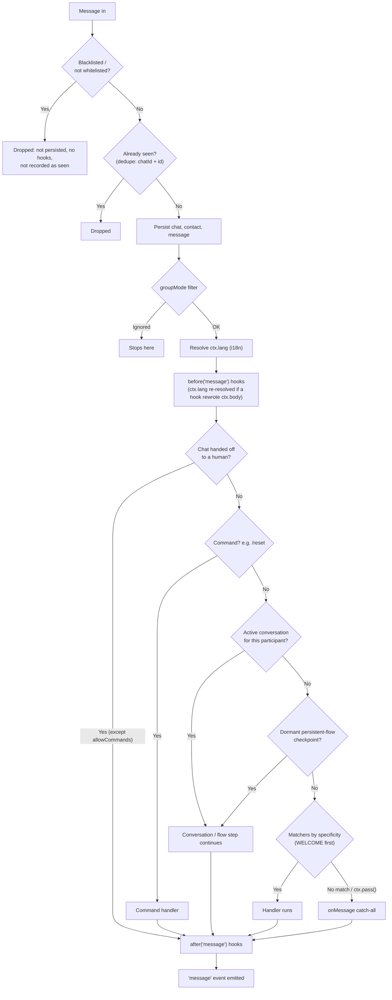

# Core Concepts

A bot is a `Bot` plus a **provider** (the transport), and the pieces you
register on it: handlers, flows, hooks and plugins. This page shows each
piece, the `ctx` object every handler receives, and the order in which an
incoming message goes through them.

## The building blocks

### Bot and provider

```ts
import { Bot } from '@botmesh/core'
import { BaileysProvider } from '@botmesh/baileys'

const bot = new Bot({ provider: new BaileysProvider({ session: 'my-bot' }) })
// register handlers, flows, hooks and plugins here, then:
await bot.start()
```

The `Bot` (from `@botmesh/core`) is the transport-agnostic engine: it runs the
dispatcher, hooks, flows, conversations and the scheduler. The **provider** is
the transport: `@botmesh/baileys` (WhatsApp Web), `@botmesh/meta` (WhatsApp
Cloud API), `@botmesh/telegram` and the [other channels](./channels) all feed
the bot the same normalized events, so the code you register works on any of
them. Every option of `new Bot()` is in the
[configuration reference](./configuration).

### `when`: simple responses

```ts
bot.when('hello', async (ctx) => {
  await ctx.reply('👋 Hello!')
})
```

When a message matches the trigger, the handler runs. A plain string matches by
**normalized equality**: case, accents and extra spaces are ignored, so
`'hello'` matches "Hello" and "  héllo ", but not "/hello" or "hello there".
Triggers take other forms too:

| Trigger | Matches |
| --- | --- |
| `'hello'` | the text, normalized |
| `['bye', 'goodbye']` | any of them |
| `/\d{4,}/` | a regular expression |
| `{ pattern: 'invoice', match: 'contains', scope: 'dm' }` | `match`: `'equals'` (default), `'contains'`, `'startsWith'` or `'endsWith'`; `scope`: `'dm'`, `'group'` or `'all'` |
| `(m) => m.body.length > 200` | a synchronous predicate on `{ body, isGroup }` |
| `IMAGE`, `LOCATION`, `WELCOME`, `CALL`… | message types and special events, see [Special triggers](./triggers) |

`bot.command('help', handler)` registers a `/help` command (the prefix is
`commandPrefix`), and `bot.onMessage(handler)` is the catch-all for whatever
nothing else handled.

### `flow` and `conversation`: multi-step conversations

```ts
import { flow } from '@botmesh/core'

const signup = flow('signup')
  .ask('Your name?', 'name')
  .say((_ctx, c) => `Hi ${c.state.name}`)

bot.use(signup)
```

A **flow** is a chainable description of a conversation: the bot asks, the
user answers, `c.state` keeps the answer and the flow continues, with
validation, retries, menus and timeouts. It compiles to the same runtime as
`bot.conversation(name, async (c, ctx) => { ... })`, which you write by hand
when you need loops or arbitrary logic. See [Conversation flows](./flows).

### Hooks: middleware

```ts
bot.before('message', async (ctx, next) => {
  bot.logger.debug({ type: ctx.type }, 'message in')
  await next()                      // without next() the message stops here
})

bot.onError('message', async (ctx, error) => {
  await ctx?.reply('😅 Something went wrong, try again.')
})
```

`before` hooks run before routing and can stop or rewrite a message; `after`
hooks run once it was handled; `onError` hooks run when a handler throws.
`'send'` hooks see every outgoing message. See [Hooks](./hooks).

### Plugins: packaged features

```ts
import { slashCommandsPlugin } from '@botmesh/core'

const unplug = bot.plug(slashCommandsPlugin, { greeting: 'Hi! Send /help.' })
```

A plugin bundles handlers, hooks and tools. `bot.plug()` returns an `unplug()`
function that reverts what the plugin registered. A plugin `name` can be
plugged once per bot unless its spec sets `multiple: true`. See
[Plugins](./plugins).

## The `ctx` object

Every handler receives a `MessageContext`. What it **tells** you:

| Field | What it holds |
| --- | --- |
| `ctx.body` | The text, or the caption of a media message (`''` when there is none). |
| `ctx.type` | `'text'`, `'image'`, `'video'`, `'audio'`, `'voice'`, `'document'`, `'sticker'`, `'location'`, `'contact'`, `'poll'`, `'buttons'`, `'call'`… |
| `ctx.from` | The chat id: where replies go. |
| `ctx.sender` | Who sent it: the same as `from` in a DM, the participant in a group. |
| `ctx.senderInfo` | `{ id, displayName?, language?, … }` as the provider reports it. |
| `ctx.isGroup`, `ctx.isPrivate` | Chat kind. |
| `ctx.timestamp` | When it was sent, epoch milliseconds on every channel. |
| `ctx.ref` | `{ id, chatId }` of this message, to quote, react to, edit or delete it. |
| `ctx.quoted`, `ctx.mentions` | The message it replies to, and the users it mentions. |
| `ctx.media`, `ctx.sharedLocation` | Media metadata (download it with `loadMediaOf(ctx)`) and a received location. |
| `ctx.interaction` | A button or list tap: `{ id, data }`. |
| `ctx.lang`, `ctx.user`, `ctx.tools` | The resolved language, the user's [persistent data](./user-data) and the [injected tools](./plugins#share-tools-dependency-injection). |

What it **does**:

| Method | What it does |
| --- | --- |
| `ctx.reply(text)` | Send text to the chat. |
| `ctx.photo()`, `ctx.video()`, `ctx.audio()`, `ctx.voice()`, `ctx.file()`, `ctx.sticker()` | Send media. |
| `ctx.location()`, `ctx.contact()`, `ctx.poll()`, `ctx.buttons()` | Send a location, a contact card, a poll or buttons. |
| `ctx.quote(text)`, `ctx.react(emoji)`, `ctx.edit(…)`, `ctx.delete()` | Reply quoting the message, react to it, edit or delete a message. |
| `ctx.stream(source)` | Send text as it is generated. See [Streaming](./streaming). |
| `ctx.typing()`, `ctx.recording()`, `ctx.markRead()` | Presence hints (best effort). |
| `ctx.supports(feature)` | Whether the channel can do something, before you try. |
| `ctx.t(key, params)`, `ctx.setLang(code)` | Translate, and change the user's language. See [i18n](./i18n). |
| `ctx.handoff()` | Hand the chat to a human. See [Handoff](./handoff). |
| `ctx.pass()`, `ctx.abort()` | Let the next handler take the message; stop it (in `before` hooks). |

Every send helper is covered in [Messages & media](./messages).

## Chat and sender ids

`ctx.from` (chat) and `ctx.sender` (user) are **opaque strings** the provider
chooses; the core never parses them. Store and compare them as they arrive.
On WhatsApp (Baileys) they are JIDs:

| Kind | Format | Example |
| --- | --- | --- |
| User | `number@s.whatsapp.net` | `573001234567@s.whatsapp.net` |
| Group | `id@g.us` | `120363xxx@g.us` |
| Newsletter | `id@newsletter` | `120363xxx@newsletter` |

Telegram uses numeric chat ids, the Cloud API phone numbers, and so on. The
provider also resolves aliases: the same person always arrives with the same
`ctx.sender`, even when WhatsApp switches between a phone number and a LID.

## The inbound pipeline

Every incoming message goes through the same steps, in this order. The first
four run as soon as the provider emits the event; the rest run on a **FIFO
queue per chat**, so two messages from the same chat are never processed at
the same time. The first handler that **consumes** the message stops the
routing:



Before step 1 the bot drops its own messages (`fromMe`) and, when
[`echoFilter`](#echo-filter) is on, echoes of its own sends.

1. **Blacklist / whitelist**: a blocked sender or chat is dropped silently. It
   is not persisted, no hooks run, no `'message'` event fires and it is **not
   recorded as seen**, so a redelivery after un-blocking is processed. See
   [Handoff & access lists](./handoff#blacklist-and-whitelist).
2. **Inbound dedupe**: a redelivered message (same `chatId` + id, from a
   webhook retry or a reconnect) is dropped. See [Inbound dedupe](#inbound-dedupe).
   With [durable processing](./durability) on, the event is then written to
   the inbox journal, so it is replayed from step 1 after a crash.
3. **Persistence**: the chat, contact and message are saved in the store.
4. **`groupMode` filter**: a group message the bot must ignore stops here
   (it is still persisted).
5. **Language, then `before('message')` hooks**: with [i18n](./i18n) on,
   `ctx.lang` is resolved first, so hooks and handlers already see it. Then the
   hooks run and may `abort()` the message. If a hook rewrote `ctx.body` (the
   `@botmesh/voice` transcript, for instance) and the language came from
   `detect` or the default, it is resolved again on the new text.
6. **Handoff gate**: while a chat is [handed off to a human](./handoff), steps
   7–11 are skipped (except `handoff.allowCommands`). The message is still
   persisted, hooks still run and `'message'` still fires.
7. **Commands** (`/reset`, `/help`…) always win, even over an active
   conversation. That is what lets `/reset` escape a stuck flow.
8. **Active conversation**: if this participant is in a flow or
   `bot.conversation` waiting for a reply, the message goes there.
9. **Dormant resume**: a `.persistent()` flow checkpointed in the store (for
   example before a restart) resumes at the saved step.
10. **Matchers** registered with `bot.when()` and `bot.onType()`, by
    specificity: [`WELCOME`](./triggers#welcome) (first contact only), then
    exact text, `startsWith`, `endsWith`, regex, `contains`, predicates,
    single types (`IMAGE`) and multi-type triggers (`MEDIA`). With equal
    specificity, the one registered first wins. See
    [Precedence](./triggers#precedence).
11. **`bot.onMessage()`**: the catch-all (`aiPlugin` is one). It runs **only**
    if nothing above consumed the message.
12. **Finish**: `after('message')` hooks, then the `'message'` event
    (`bot.onIdle` timers re-arm here).

If a handler throws, the `onError('message')` hooks run and the error is
emitted on `bot.on('error', ({ error, ctx }) => ...)`, whether or not an error
hook exists.

### Handlers consume by default

Once a handler runs, routing stops there. Call `ctx.pass()` to hand the
message to the next matching handler instead:

```ts
bot.when(/.+/, async (ctx) => {
  if (ctx.type === 'image') { ctx.pass(); return } // let the image handler take it
  await ctx.reply('text received')
})

bot.onType('image', async (ctx) => {
  await ctx.reply('image received')
})
```

### `'message'` event vs `onMessage()`

- `bot.on('message', ctx => ...)` fires for **every** message the dispatcher
  finished, including ones a command, a conversation or a `when` handler
  consumed. Use it for logging and inbox integrations.
- `bot.onMessage(ctx => ...)` is the **catch-all** handler: it runs only when
  nothing else consumed the message.

### Calls, `bot.trigger()` and replicas

- **Calls** take a shorter path: the access-list and handoff gates come
  **first** and block a call completely (no `'call'` hooks, event or `CALL`
  trigger; counted in `metrics().dropped`). An admitted call runs the
  `before`/`after('call')` hooks and the `'call'` event, then only
  [`CALL` triggers](./triggers#call): no message hooks, commands or `'message'`
  event.
- **`bot.trigger(name, { chatId })`** starts a flow without an inbound message
  (see [Starting a flow programmatically](./messages#starting-a-flow-programmatically)).
  It checks the access lists, waits for the chat's FIFO slot, checks the
  handoff gate, resolves the language and starts the conversation. No dedupe,
  persistence, message hooks, matchers or `'message'` event.
- **With [`coordination`](./replicas)** (several replicas), one more step sits
  between 4 and 5: the message waits for its chat's **turn**, so the FIFO per
  chat holds across replicas. A message whose turn cannot be had is dropped and
  reported on `'error'` (its dedupe id is released, so a redelivery is
  processed).

## Group conversations are per participant

In a group, two participants talking to the bot get **independent
conversations** by default: one can be halfway through a sign-up while the
other asks for the menu. Set `conversationScope: 'chat'` for a single shared
conversation per group:

```ts
const bot = new Bot({ provider, conversationScope: 'chat' })
```

Handoff, `groupMode` and the `'message'` event stay per chat either way.

## Inbound dedupe

Webhook transports (Cloud API, Messenger, Instagram, Telegram webhook) retry a
delivery when they don't get a 2xx in time, and Baileys can redeliver recent
messages after a reconnect. Without protection the same message would start a
flow twice, or be taken as the answer to the *next* question. The bot drops
redeliveries before any handler sees them. It is **on by default**:

```ts
new Bot({ provider })                                     // default: { size: 1000 }, no TTL
new Bot({ provider, dedupe: { size: 5000, ttl: '1h' } })  // tune it
new Bot({ provider, dedupe: false })                      // turn it off
```

- A message is keyed by `chatId` + `ref.id` (some transports only make ids
  unique per chat). A button or list tap is keyed by its `interactionId`, so
  two taps on the same menu are two events.
- **Edits**: the same id with a **different** body (a Telegram edit) is
  processed; an identical retry is dropped. Only a hash of the body is kept.
- Events with an empty id are never deduplicated.
- A blocked message is never recorded, so the same id redelivered after
  un-blocking is processed.
- If persistence fails before the handlers run (store down), or the message is
  still queued when `bot.stop()` runs, the key is released so a redelivery is
  processed.
- `size` bounds an LRU; `ttl` (a [duration](./configuration#durations)) counts
  from the first acceptance.
- **Limit:** it lives in process memory, so it does not deduplicate across
  replicas or after a restart. [Durable processing](./durability) covers that.

Providers must give each inbound event an id that names exactly one event,
stays the same when it is redelivered, and is `''` when the transport cannot
guarantee that (the **inbound id contract** on `IProvider`).

## Echo filter

Every provider marks the bot's own messages with `fromMe`, and the core drops
them first. A few transports only learn their own id after a handshake, and a
mailbox or gateway can hand back a message the bot just sent without that mark.
`echoFilter` adds a second guard: the bot remembers the refs of its successful
sends and drops an inbound message carrying one of them, before the access
lists, dedupe and the journal.

```ts
new Bot({ provider, echoFilter: true })                       // 1000 refs, no TTL
new Bot({ provider, echoFilter: { size: 5000, ttl: '10m' } }) // tune it
```

It is off by default. Drops count in `metrics().dropped.echo` (Prometheus:
`botmesh_inbound_dropped_total{reason="echo"}`). The memory is per process, and each
remembered ref is consumed by the first echo that matches it.

## Package entries

| Import from | For |
| --- | --- |
| `@botmesh/core` | Applications: the `Bot`, the flow DSL, the message types, the options and the errors you can catch. |
| `@botmesh/core/testing` | Tests: `createTestBot`, `MockProvider`, the chaos kit, golden transcripts, crash simulation and `MemoryCoordinator`. See [Testing](./testing). |
| `@botmesh/core/testing/vitest` | Vitest matchers (`toHaveReplied`…). |
| `@botmesh/core/spi` | Authors of stores, durability backends, schedule stores, coordinators, tracer integrations and transports: `KvDurability`, `MemoryKv`, `MemoryScheduleStore`, `messageKey`, `toInboundLocation`, the record types… Covered by semver. |
| `@botmesh/core/dev` | The `botmesh dev` [terminal simulator](./dev-simulator). |
| `@botmesh/core/internal` | Engine classes (`Dispatcher`, `ConversationRuntime`, `HookSystem`…). No semver guarantee: do not use it from an application. |

## Next steps

- [Configuration reference](./configuration): every `new Bot()` option, events, logging and errors
- [Messages & media](./messages): all reply types
- [Conversation flows](./flows): multi-step conversations
- [Special triggers](./triggers): WELCOME, message types and CALL
- [Hooks](./hooks): middleware
- [Examples](/examples/): practical recipes
